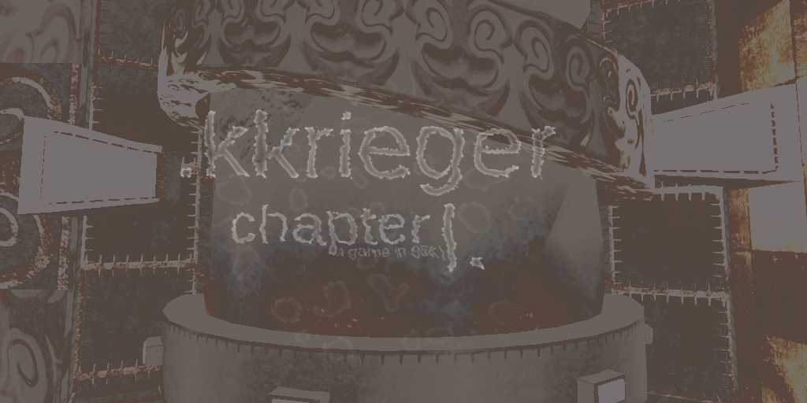
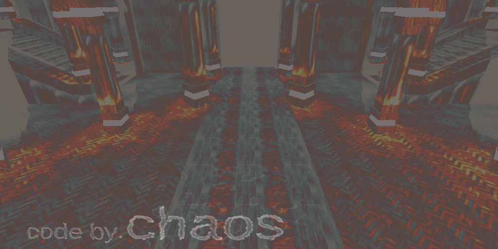
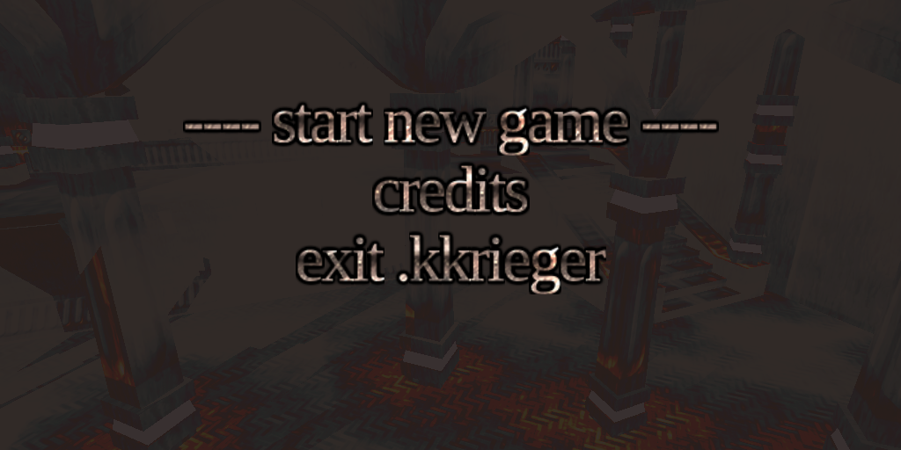
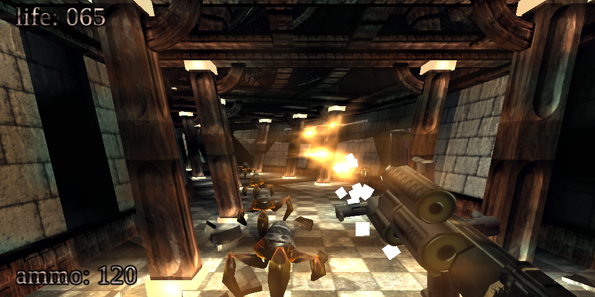
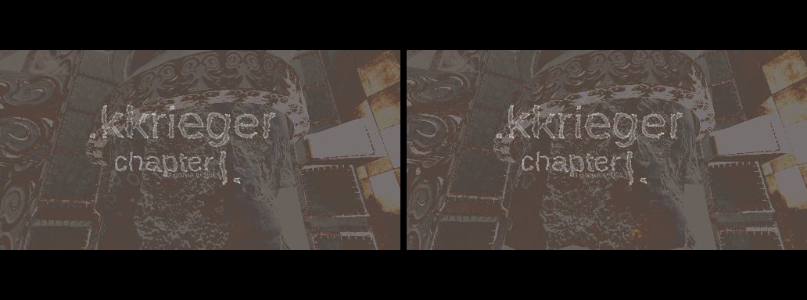
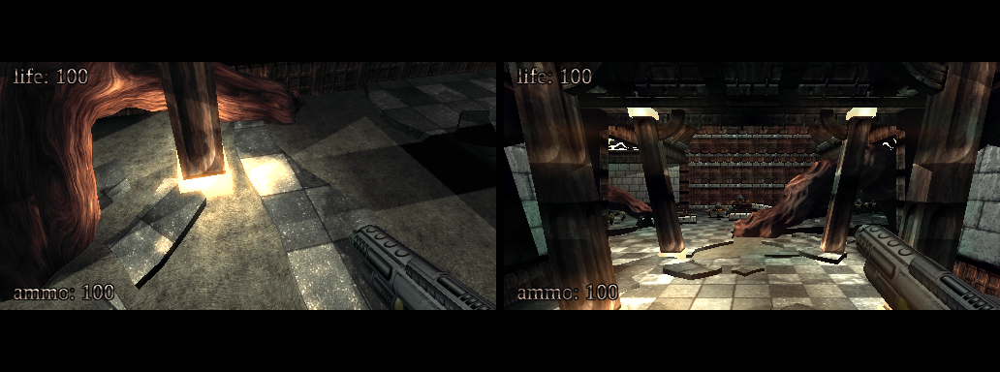

# .kkrieger — reverse engineered, ported to Linux, packed into 95 KB

[.kkrieger](https://www.pouet.net/prod.php?which=12036) is the famous 96k
first-person shooter by .theprodukkt (farbrausch) that won the 96k game
competition at Breakpoint 2004: a complete 3D game whose textures, meshes,
level and music are all generated at load time from a 97,280 byte executable.

This repository takes the original `pno0001.exe` apart and puts it back
together on Linux:

* **unpacked and decompiled** the kkrunchy-packed executable,
* **ported** the game to native 32-bit Linux, using farbrausch's
  open-sourced engine code and the original 2004 game data — in three
  versions: OpenGL, Vulkan and Direct3D 9 on DXVK,
* **recovered the 2004 code** that is missing from the public source — most
  notably the complete particle physics and monster AI — from the binary,
* checked it **against the original**, running the original under Proton,
  frame by frame,
* and **packed the result back** into a single executable of
  **95,088 bytes** (OpenGL version) — 2,192 bytes smaller than the
  original's 97,280.

| Title | Credits |
| --- | --- |
|  |  |
| **Main menu** | **Game play** |
|  |  |

Original (left) and port (right), same frame:




## Results

|  |  |
| --- | --- |
| Platform | Linux, i386 (runs on x86-64 with 32-bit libraries) |
| Graphics | OpenGL 4.5, Vulkan 1.3 or Direct3D 9 on DXVK-native — three versions, see below |
| Sound | V2 synthesizer from its original assembly source, SDL3 audio + software mixer |
| Data | the original 2004 `.kx` document, extracted from `pno0001.exe` |
| Game play | intro, menu, weapons, monsters, pickups, doors and the recovered 2004 physics |
| Size | one packed executable of **95,088 bytes** (original 97,280) |
| Verification | 3,634 generated textures/meshes hashed, deterministic screenshot runs |

## Three versions

The game code, the data, the size build and the packer are the same in all
three; they differ in how they draw. Each version is a complete port in its
own folder with its own Makefile and technical notes.

|  | [`port/opengl`](port/opengl) | [`port/vulkan`](port/vulkan) | [`port/dxvk`](port/dxvk) |
| --- | --- | --- | --- |
| Graphics API | OpenGL 4.5 core, direct state access | Vulkan 1.3, dynamic rendering, push descriptors | Direct3D 9, translated to Vulkan by DXVK-native |
| Renderer | own, `src/glrender.cpp` (724 lines) | own, `src/vkrender.cpp` (1,560 lines) | the engine's original Direct3D 9 code (`src/_startdx.hpp`) |
| Shaders | 62 GLSL shaders, minified text (39 KB), compiled by the driver at start | the same 62 GLSL shaders, compiled to SPIR-V (83 KB) at build time | generated at load time by the 2004 engine's shader generator (D3D9 bytecode) |
| Imports | by hash (no symbol names, PLT or version tables) | dynamic linking | dynamic linking |
| Needed to run | an OpenGL 4.5 driver | a Vulkan 1.3 driver + loader | a Vulkan driver + `libdxvk_d3d9.so.0` (7.6 MB) next to the exe |
| Needed to build | GL headers (libglvnd) | `glslc`, Vulkan headers | DXVK-native (`tools/get_dxvk.sh`) |
| Size build, unpacked | 341,504 bytes | 395,988 bytes | 307,336 bytes |
| Stub (unpacker) | 2,383 bytes | 2,383 bytes | 2,494 bytes (adds `LD_LIBRARY_PATH`) |
| **Packed executable** | **95,088 bytes** | **101,387 bytes** | **95,336 bytes** + the library |
| vs. original (97,280) | −2,192 | +4,107 | −1,944, but needs 7.6 MB more |
| Output | reference | same hashes, screenshots within 0.02% | same hashes, same screenshots |

The DXVK version came first: it keeps the engine's Direct3D 9 code and is
small because DXVK — like Direct3D 9 for the original — is outside the
executable. The Vulkan version draws by itself, with precompiled shaders, and
is the largest. The OpenGL version draws by itself too but leaves pipelines
and shader compilation to the driver; it is the smallest self-contained one.

## Quick start

Requirements (Fedora package names; other distributions have the same
libraries): `clang nasm python3 glibc-devel.i686 libstdc++-devel.i686
SDL3-devel SDL3.i686 fontconfig.i686 freetype.i686 liberation-sans-fonts
liberation-serif-fonts`, and per version:

* `port/opengl`: `libglvnd-devel libglvnd-opengl.i686 libglvnd-glx.i686
  mesa-dri-drivers.i686` (or the 32-bit NVIDIA driver) — any GPU with an
  OpenGL 4.5 driver. OpenGL runs on the default GPU; with two GPUs start it
  with `prime-run` (or the `__NV_PRIME_RENDER_OFFLOAD=1
  __GLX_VENDOR_LIBRARY_NAME=nvidia` variables) for the discrete one.
* `port/vulkan`: `vulkan-headers glslc vulkan-loader.i686
  mesa-vulkan-drivers.i686` (or the 32-bit NVIDIA driver) — a Vulkan 1.3
  driver; the first discrete GPU is used.
* `port/dxvk`: `vulkan-loader.i686 mesa-vulkan-drivers.i686` and `curl`;
  `tools/get_dxvk.sh` downloads DXVK-native.

```sh
cd port/opengl             # or port/vulkan, port/dxvk (run tools/get_dxvk.sh first)
make pack                  # build-small/kkrieger.packed
./build-small/kkrieger.packed            # 1024x768 window like the original
./build-small/kkrieger.packed -f         # fullscreen
./build-small/kkrieger.packed -r 1920x960

make                       # build/kkrieger: -O2 with symbols and debug options
./build/kkrieger
```

Controls are the original ones: mouse + W/A/S/D, left mouse button fires,
space jumps, 1–9 select weapons; arrow keys and Enter in the menu.

## Repository layout

| Path | Contents |
| --- | --- |
| `original/pno0001.exe` | the original 97,280 byte executable (kkrunchy-packed) |
| `unpacked/` | the unpacked executable (`pno0001_unpacked.exe`, 255 KB, opens directly in Ghidra/IDA/r2), its import list and entry point |
| `decomp/` | Ghidra output: all 573 functions (`decompiled_all.c`, operator handlers named) and a readable dump of the game data (`kx_release_ops.txt`, 4,816 operators) |
| `port/opengl/` | the OpenGL version: sources, Makefile, technical notes in [`port/opengl/README.md`](port/opengl/README.md); `tools/shaderpack.py` (minifies the GLSL), `tools/mkimports.py` (import by hash) |
| `port/vulkan/` | the Vulkan version, notes in [`port/vulkan/README.md`](port/vulkan/README.md); `tools/shaderpack.py` (GLSL → SPIR-V) |
| `port/dxvk/` | the DXVK version, notes in [`port/dxvk/README.md`](port/dxvk/README.md); `tools/get_dxvk.sh`, `tools/d3dbc_dis.py` (D3D9 shader disassembler) |
| `port/*/src/data/pno0001_release.kx` | the game data as stored in the original executable |
| `tools/kkrunpack.c`, `tools/rebuild_pe.py` | kkrunchy unpacker and PE rebuilder |
| `tools/ghidra/`, `tools/ghidra_labels.txt` | headless Ghidra script that names functions from the operator table |
| `tools/kxdump.py`, `tools/opdef_diff.py`, `tools/opsig_check.py` | 2004 `.kx` parser, operator definition comparison against the source |
| `tools/unifdef.py`, `tools/kkrieger_player.cfg` | reduces the source to the kkrieger player configuration |
| `tools/v2_asm_to_elf.py` | makes the V2 synth's MASM-flavoured NASM source assemble as ELF |
| `tools/hook/` | code cave for the original exe: frame dumps, key injection, player position log (for comparisons under Proton) |
| `tools/kkpack/` | the executable packer of all three versions: context mixing model (from kkrunchy_k7), x86 DisFilter, ELF stub; `tune.py` searches its context masks |
| `tools/kxtranspose.py` | reorders the `.kx` document for better compression |
| `tools/packprof.py` | what each object file or function costs in the pack |
| `tools/coverage/`, `tools/verify_small.sh`, `tools/shotcmp.py` | coverage runtime and the verification harness of the size build |
| `tools/raw2png.py`, `tools/tga2png.py`, `tools/sidebyside.py` | screenshot conversion and side-by-side images |
| `docs/` | screenshots and original/port comparison images |

Not in the repository (see `.gitignore`): `reference/fr_public` (clone of
[farbrausch/fr_public](https://github.com/farbrausch/fr_public)),
`unpacked/image.bin` (raw memory dump), the Ghidra project database,
DXVK-native (`port/dxvk/third_party`) and the build directories.

## How it was done

### 1. Unpacking

The executable is packed with kkrunchy (an early, LZ + arithmetic coding
version). `tools/kkrunpack.c` maps the PE at its preferred image base in a
32-bit Linux process, fakes `LoadLibraryA`/`GetProcAddress`, runs the original
depacker stub natively and single-steps the second stage with the trap flag
until the original entry point (0x805427). `tools/rebuild_pe.py` turns the
memory dump into a clean PE with a rebuilt import table (4 DLLs, 44 imports;
d3d9 and dsound are loaded at run time).

```sh
gcc -m32 -O1 -o tools/kkrunpack tools/kkrunpack.c
tools/kkrunpack original/pno0001.exe unpacked
python3 tools/rebuild_pe.py unpacked/image.bin unpacked/imports.txt unpacked/info.txt unpacked/pno0001_unpacked.exe
```

### 2. Decompiling

Headless Ghidra with a script that names the operator handlers from the
operator table in the binary, then decompiles everything:

```sh
analyzeHeadless ghidra/project pno0001 -import unpacked/pno0001_unpacked.exe -overwrite \
    -scriptPath tools/ghidra -postScript KKAnalyze.java tools/ghidra_labels.txt decomp
```

The game data is embedded at 0x82168c (122,012 bytes): the V2 song, the sound
effect tune, 77 operator classes, 4,816 operators, 18 events and 38 splines.
`tools/kxdump.py` parses this 2004 export format (reconstructed from the
decompiled loader).

### 3. Porting

farbrausch released the werkkzeug3/kkrieger source in 2012 (BSD), but it is a
**later revision** than the 2004 release: the export format, the parameter
layout of several operators, the text, viewport and material code, the V2
patch format — and the physics — differ or are missing. The port starts from
that source (reduced to the player with `tools/unifdef.py`), replaces the
Win32/DirectSound/GDI layer with SDL3, a software mixer and
fontconfig/FreeType, and puts the 2004 behaviour back wherever the data needs
it: the 2004 loader, the old operator layouts, the 2004 text renderer, the
missing root operator, and the complete **2004 physics** (Verlet particle
bodies, sliding collision, moving doors, shot particles, monster AI and
walking), translated from the disassembly into `port/*/src/kkphysic.cpp`.

MSVC 2003 code did not always survive clang: implicit `eax`/`st0` returns from
inline assembly, variadic arguments read as `(&param)[i]`, and separate
by-value parameters assumed to be contiguous on the stack — invisible in
debug builds, fatal once clang inlined them (all pickups collapsed to the
origin; all geometry was subdivided wrong).

The full list is in [`port/opengl/README.md`](port/opengl/README.md#what-the-port-changes).

### 4. Graphics: Direct3D 9, Vulkan, OpenGL

**DXVK** (`port/dxvk`): the first version kept the engine's Direct3D 9 code
unchanged and ran it on DXVK-native, which translates Direct3D 9 to Vulkan.
The 2004 engine generated its material shaders at load time: per material it
ran a shader "metaprogram" over the material parameters (combiners, lighting
mode, texture flags) and produced Direct3D 9 shader bytecode.

**Vulkan** (`port/vulkan`): to drop Direct3D, the 48 materials of the game
data — they produce 21 vertex and 41 pixel shaders — were converted once to
GLSL (`port/*/src/shaders/`), and `materials.txt` maps each material,
identified by the fields its shaders depend on, to its pair; the shader
generator is gone. `src/vkrender.cpp` draws with Vulkan 1.3: render states
written by the material code directly as Vulkan values, pipelines cached by
shaders, vertex format, blending and colour mask, dynamic state for depth,
stencil (incl. two-sided), cull mode, scissor and depth bias, dynamic
rendering, push descriptors, two frames in flight. The shaders are compiled
to SPIR-V with `glslc`; `tools/shaderpack.py` gives every module the same ids
for the same types, constants and interface variables, so the 83 KB of
SPIR-V pack into about 4 KB, with no decoder in the executable.

**OpenGL** (`port/opengl`): the same GLSL shaders, minified by
`tools/shaderpack.py` (comments, white space, unused constants removed,
interface names shortened) — the 39 KB of text cost 1.3 KB in the pack — and
compiled by the driver at start as separable programs, combined per material
in program pipelines. `src/glrender.cpp` draws with OpenGL 4.5 core and
direct state access: render states as GL values, applied only when something
changed, two uniform buffers for the vertex/pixel constants, two-sided
stencil for the shadow volumes.

All three keep the engine's conventions: y-up clip space with z in 0..1
(OpenGL: `glClipControl(GL_UPPER_LEFT, GL_ZERO_TO_ONE)`), pixel centres at
integer coordinates, clockwise front faces, the alpha test on 8-bit values.
Against the DXVK version, the 3,634 generated textures/meshes — many of them
rendered on the GPU and read back — are bit-identical in the Vulkan and
OpenGL versions; the screenshots differ in at most 0.02% of the pixels, by at
most 4/255. The Khronos validation layer (Vulkan, with synchronization
validation) and the GL debug output report no errors.

### 5. Matching the original

The original runs under Proton 11. `tools/hook/patch_pe.py` adds a code cave
to the unpacked exe that hooks `Present` and dumps the back buffer at fixed
times, can start straight into the game, disables the mouse look that drifts
under XWayland, injects key presses and logs the player position from the
game object. Intro, menu and game were compared frame by frame; the
deterministic port options (`KK_FIXEDTIME`, `KK_KEYS`, `KK_SHOT`) make the
port's side reproducible.

### 6. Packing

The original was packed with kkrunchy and stripped with *lekktor*, a code
coverage tool that removed every piece of code not executed while playing
through the game ([the story](https://fgiesen.wordpress.com/2012/04/08/metaprogramming-for-madmen/)).
The port does the same with a little more care:

* **Packer** (`tools/kkpack`, used by all three versions): the context mixing
  model of kkrunchy_k7 and its x86 DisFilter
  ([x86 code compression in kkrunchy](https://fgiesen.wordpress.com/2011/01/24/x86-code-compression-in-kkrunchy/)),
  with opcode tables updated for clang's SSE code, inside a hand-written ELF
  stub that unpacks into a memfd and `execveat`s it. The model was made
  stronger for this executable: 14 instead of 11 context models with
  searched context masks (`tools/kkpack/tune.py`), a state map per model,
  six mixers instead of three, a final mixer per partial byte, an order-1
  APM — about 1.9 KB smaller than the unchanged model, for 74 bytes more
  stub. Unpacking takes about 1.7 s.
* **Imports by hash** (OpenGL version; `port/opengl/tools/mkimports.py`,
  `port/opengl/linux/imports.cpp`): the size build carries no symbol names,
  PLT or version tables; at start it finds its imports in the GNU hash
  tables of the loaded libraries (−0.9 KB).
* **Compiler**: flags chosen by *packed* size (x87, LTO and the machine
  outliner make smaller code that packs worse), no CRT start files,
  no libstdc++.
* **Platform**: FreeType instead of a built-in TrueType rasterizer (−7 KB
  packed), sound effects and fonts from system libraries — like gdi32 and
  dsound were for the original.
* **Data**: the V2 tunes are converted at build time; the `.kx` document is
  stored with operator parameters column-major (−1.2 KB).
* **Code**: lekktor-style removal of what the 2004 data never uses (unused
  animation opcodes and viewport modes, skinning, sprite materials, material
  chaining, error paths …) — but every case checked against the data
  (`KK_OPSTATS`, basic block coverage) and compiled out with
  `#ifdef KK_SMALL` instead of patched out of the binary.
* **Verification**: `tools/verify_small.sh port/<version> DIR` hashes all
  3,634 generated textures and meshes and takes 13 deterministic
  screenshots; the size build matches the general code bit for bit.

|  | bytes |
| --- | ---: |
| original `pno0001.exe` | 97,280 |
| `port/opengl/build/kkrieger` (-O2, symbols) | 1,927,632 |
| `port/opengl/build-small/kkrieger` (unpacked) | 341,504 |
| **`port/opengl/build-small/kkrieger.packed`** | **95,088** |
| `port/vulkan/build-small/kkrieger.packed` | 101,387 |
| `port/dxvk/build-small/kkrieger.packed` (+ 7.6 MB `libdxvk_d3d9.so.0`) | 95,336 |

## Known differences

* The game scene is about 15% brighter than the original: the port uses the
  later engine's per-light renderer, the 2004 engine had a different light
  pass structure.
* The 2004 game tick ran with the FPU rounding toward −∞, which makes a
  resting player slowly slide (measurable in the original). The port uses
  round-to-nearest.
* Small differences in procedural textures from float→int rounding (MSVC
  `/QIfist` vs. clang).

More in [`port/opengl/README.md`](port/opengl/README.md#known-issues).

## Tools used

* [Ghidra](https://github.com/NationalSecurityAgency/ghidra) 12.1 (headless) — decompilation
* [clang/LLVM](https://llvm.org) 22, [NASM](https://www.nasm.us), Python 3, lldb, sanitizer coverage
* [OpenGL](https://www.opengl.org) 4.5 through [libglvnd](https://github.com/NVIDIA/libglvnd) — the OpenGL version
* [Vulkan](https://www.vulkan.org) 1.3, [shaderc](https://github.com/google/shaderc) (`glslc`), the [Khronos validation layer](https://github.com/KhronosGroup/Vulkan-ValidationLayers) and [SPIRV-Tools](https://github.com/KhronosGroup/SPIRV-Tools) (`spirv-val`) — the Vulkan version
* [DXVK](https://github.com/doitsujin/dxvk)-native 3.1.1 — the DXVK version
* [SDL3](https://github.com/libsdl-org/SDL) — window, input, audio
* [FreeType](https://freetype.org) and [fontconfig](https://www.freedesktop.org/wiki/Software/fontconfig/) with the [Liberation fonts](https://github.com/liberationfonts/liberation-fonts) — text rendering
* [Proton](https://github.com/ValveSoftware/Proton) 11 — running the original for comparison
* Claude Code — analysis and implementation assistant

## References

* .kkrieger on pouët: <https://www.pouet.net/prod.php?which=12036>
* .kkrieger on Wikipedia: <https://en.wikipedia.org/wiki/.kkrieger>
* farbrausch's source release (werkkzeug3/kkrieger, kkrunchy, V2): <https://github.com/farbrausch/fr_public>
* Fabian "ryg" Giesen, *x86 code compression in kkrunchy*: <https://fgiesen.wordpress.com/2011/01/24/x86-code-compression-in-kkrunchy/>
* Fabian "ryg" Giesen, *Metaprogramming for madmen* (lekktor and .kkrieger): <https://fgiesen.wordpress.com/2012/04/08/metaprogramming-for-madmen/>
* OpenGL 4.5 core specification: <https://registry.khronos.org/OpenGL/specs/gl/glspec45.core.pdf>
* SPIR-V specification: <https://registry.khronos.org/SPIR-V/>
* DXVK: <https://github.com/doitsujin/dxvk>

## Credits and license

**.kkrieger** (2004) is by **.theprodukkt** (farbrausch): code by ryg, chaos
and kb, graphics by fiver and gizmo64k, music by wayfinder. The engine source
is © 2002–2012 Dierk Ohlerich, Fabian Giesen, Thomas Mahlke, Christoph Muetze,
Tammo Hinrichs, Bastian Zuehlke, released under the BSD license; the
kkrunchy_k7 model and DisFilter by Fabian Giesen are in the public domain.

The original executable and its game data (`original/`, `unpacked/`,
`decomp/`, `port/*/src/data/`) are the work of .theprodukkt/farbrausch, a
freeware release, and are included here for preservation and
interoperability; they are not covered by this repository's license.

Reverse engineering, Linux port, recovered 2004 code and tools:
**[smhgzll](https://github.com/smhgzll)**, under the same BSD license — see
[LICENSE](LICENSE).
